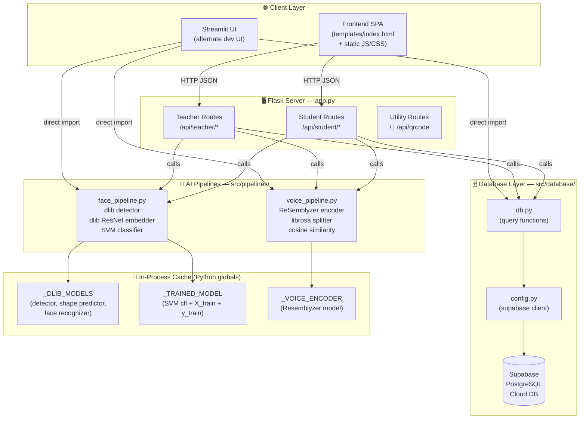

# 🏗️ System Architecture — AI Attendance Project

## Architecture Overview

The system follows a **layered 3-tier architecture**:

```
[ Browser / Frontend SPA ]
         ↓ REST API (HTTP/JSON)
[ Flask Backend — app.py ]
    ↓              ↓
[ AI Pipelines ]  [ DB Layer ]
(face/voice)      (Supabase)
```

---

## Architecture Diagram



---

## Layer-by-Layer Breakdown

### 1. Client Layer
| Component | Technology | Description |
|-----------|-----------|-------------|
| `templates/index.html` | HTML5 + Vanilla JS | Single-page app served by Flask; all API calls via `fetch()` |
| `static/css/` | CSS3 | Styling for the SPA |
| `static/js/` | JavaScript | Frontend logic, camera access, audio recording |
| Streamlit screens | Python + Streamlit | Alternate UI for desktop, uses direct function imports |

### 2. Flask Server (`app.py`)
- Entry point for all HTTP requests
- Handles request parsing, validation, and response formatting
- Calls AI pipelines and DB functions
- Serves the SPA at `/`
- **Two-step attendance flow**: AI runs first → returns preview → teacher confirms → DB write

### 3. AI Pipelines (`src/pipelines/`)

#### Face Pipeline (`face_pipeline.py`)
| Function | Role |
|----------|------|
| `load_dlib_models()` | Loads detector + shape predictor + face recognizer into `_DLIB_MODELS` global |
| `get_face_embeddings(img)` | Returns list of 128-d numpy vectors for each face in image |
| `get_trained_model()` | Fetches all students from DB, builds + caches SVM in `_TRAINED_MODEL` global |
| `train_classifier()` | Resets `_TRAINED_MODEL = None` to force retrain on next call |
| `predict_attendance(img)` | Runs full face → embed → classify → threshold pipeline |

#### Voice Pipeline (`voice_pipeline.py`)
| Function | Role |
|----------|------|
| `load_voice_encoder()` | Loads Resemblyzer `VoiceEncoder` into `_VOICE_ENCODER` global |
| `get_voice_embedding(audio_bytes)` | Returns 256-d embedding vector for a single audio clip |
| `identify_speaker(embedding, candidates, threshold)` | Cosine similarity match against stored embeddings |
| `process_bulk_audio(audio_bytes, candidates)` | Splits audio by silence → embeds each segment → identifies speakers |

### 4. Database Layer (`src/database/`)

#### `config.py`
- Reads `SUPABASE_URL` and `SUPABASE_KEY` from env
- Creates and exports a single `supabase` client instance

#### `db.py` — All Query Functions
| Function | Operation | Table |
|----------|-----------|-------|
| `check_teacher_exists(username)` | SELECT | `teachers` |
| `create_teacher(username, password, name)` | INSERT | `teachers` |
| `teacher_login(username, password)` | SELECT + bcrypt verify | `teachers` |
| `get_all_students()` | SELECT * | `students` |
| `create_student(name, face_emb, voice_emb)` | INSERT | `students` |
| `create_subject(code, name, section, teacher_id)` | INSERT | `subjects` |
| `get_teacher_subjects(teacher_id)` | SELECT + JOIN | `subjects` + `subject_students` + `attendance_logs` |
| `enroll_student_to_subject(student_id, subject_id)` | INSERT | `subject_students` |
| `unenroll_student_to_subject(student_id, subject_id)` | DELETE | `subject_students` |
| `get_student_subjects(student_id)` | SELECT + JOIN | `subject_students` + `subjects` |
| `get_student_attendance(student_id)` | SELECT + JOIN | `attendance_logs` + `subjects` |
| `create_attendance(logs)` | INSERT (bulk) | `attendance_logs` |
| `get_attendance_for_teacher(teacher_id)` | SELECT + INNER JOIN | `attendance_logs` + `subjects` |

---

## Data Storage: In-Memory vs Database

| Data | Storage Location | Persistence | Notes |
|------|-----------------|-------------|-------|
| `_DLIB_MODELS` (detector, shape predictor, face recognizer) | **Python global / RAM** | ❌ Process lifetime only | Loaded once on first face call; reloaded on server restart |
| `_TRAINED_MODEL` (SVM + embeddings array) | **Python global / RAM** | ❌ Process lifetime only | Built from DB on first predict; cleared by `train_classifier()` |
| `_VOICE_ENCODER` (Resemblyzer model weights) | **Python global / RAM** | ❌ Process lifetime only | Loaded once on first voice call |
| Teacher accounts | **Supabase DB** | ✅ Permanent | Password stored as bcrypt hash |
| Student profiles | **Supabase DB** | ✅ Permanent | Face + voice embeddings stored as JSON arrays |
| Subjects | **Supabase DB** | ✅ Permanent | |
| Enrollments | **Supabase DB** | ✅ Permanent | `subject_students` junction table |
| Confirmed attendance | **Supabase DB** | ✅ Permanent | Written only after teacher confirms |
| Pending attendance results | **Streamlit `st.session_state`** | ❌ Session only | `voice_attendance_results`, `attendance_images` |
| Logged-in teacher/student | **Streamlit `st.session_state`** | ❌ Session only | Cleared on logout/refresh |
| QR code images | **In-memory BytesIO** | ❌ Request only | Generated on-the-fly, never stored |
